# FM-1 Midi-Mania

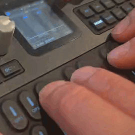

**FM-1 Midi-Mania** (Midi-Mania for short) is a rhythm-game firmware for the **M-VAVE FM-1** synthesizer. Turn a MIDI song into a chart and load it onto the FM-1.
The FM-1 plays the backing on its own synth engines while notes fall towards the keys on its screen, and you play
your part on its real keys, every press judged PERFECT, GREAT, GOOD or MISS, with a combo and a score.

This is based on **[Felucca](https://github.com/hugelton/Felucca)** by Leo Kuroshita (@kurogedelic),
Hügelton Instruments. It keeps Felucca's sound engines, audio, display, storage and USB, and replaces its groovebox side (step sequencer, arpeggiator, pattern editing) with the game.

## How it looks

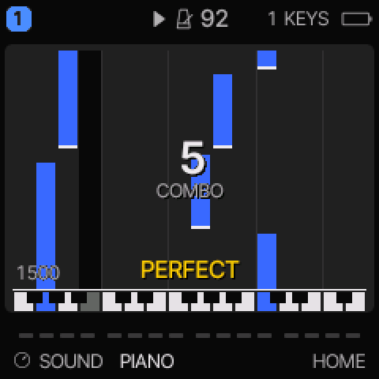

Piano (KEYS) in PLAY mode: the notes fall to the keys, each press judged, the combo and the score counting up.

<table>
<tr>
<td align="center">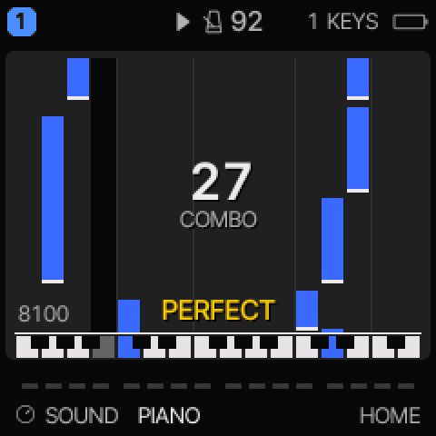<br><sub>KEYS, 27 KEYS</sub></td>
<td align="center">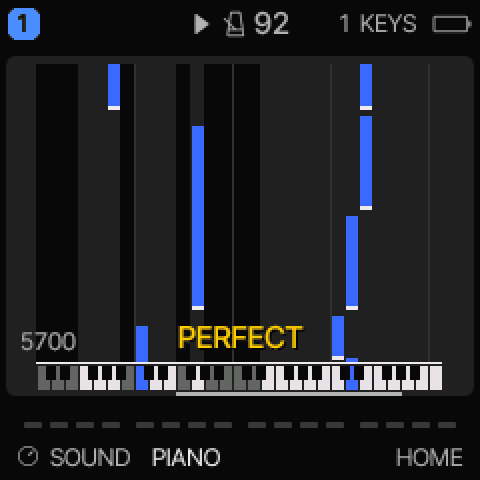<br><sub>KEYS, 49 KEYS</sub></td>
<td align="center">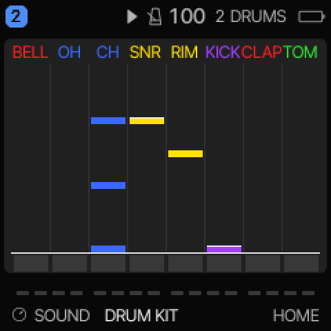<br><sub>DRUMS</sub></td>
<td align="center">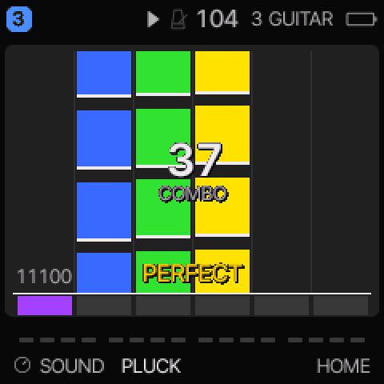<br><sub>GUITAR, STRINGS</sub></td>
</tr>
<tr>
<td align="center">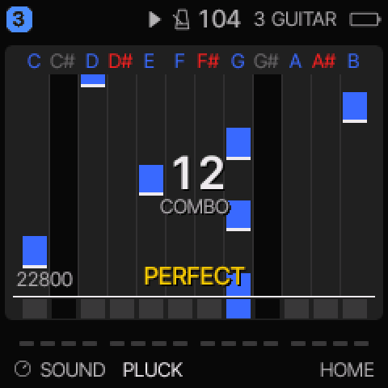<br><sub>GUITAR, CHROMATIC</sub></td>
<td align="center">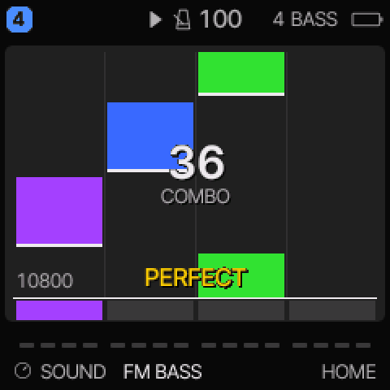<br><sub>BASS, STRINGS</sub></td>
<td align="center">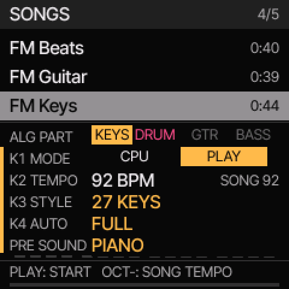<br><sub>SONGS</sub></td>
<td align="center">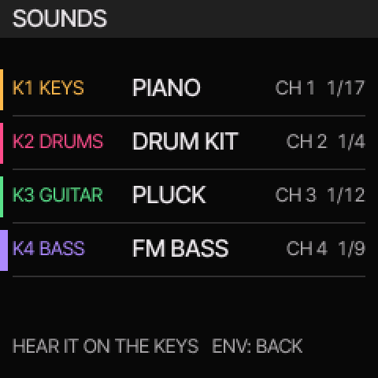<br><sub>SOUNDS</sub></td>
</tr>
</table>

## Try it

- **[Landing Page](https://shan-sherif.github.io/fm-1-midi-mania/)**: Landing page (away from the Github Repo).
- **[FM-1 Midi-Mania Studio](https://shan-sherif.github.io/fm-1-midi-mania/webapp/studio/)**: the FM-1 in your browser,
  the same code the instrument runs. Play the built-in songs or FREE PLAY, and drop your own MIDI files on the page
  to load them as songs: preview them on the FM-1's sounds first, and find them again in a song browser (search,
  sort, filter by part). No FM-1 needed; Chrome, Edge, Firefox or Safari. **Have an FM-1?** Connect it by USB on the
  same page (Chrome or Edge; Midi-Mania 0.2.0 or later) to send your songs to it, and to list and delete the ones on
  it. Up to 16 songs, 240 KB in all.
- **[The installer](https://shan-sherif.github.io/fm-1-midi-mania/webapp/installer/)**: puts Midi-Mania on your FM-1
  over USB, from Chrome or Edge. **Return to official V15** on the same page puts the stock firmware back.
- **[Releases](https://github.com/shan-sherif/fm-1-midi-mania/releases)**: each version's package and notes.

## Quick start

On the FM-1 (in Studio, the computer key in brackets; turn a knob with the mouse wheel or by dragging it):

1. **SEQ** (`0`) opens **SONGS**. Pick a song with **SELECT** (`↑` `↓`), and your part with **ALGORITHM** (`←` `→`):
   KEYS, DRUMS, GUITAR or BASS.
2. **ENV** (`3`) opens **SOUNDS** to choose the instruments: **KNOB 1** KEYS, **KNOB 2** DRUMS, **KNOB 3** GUITAR,
   **KNOB 4** BASS (MIDI channels 1 to 4). Turn a knob quickly and its whole list pops up. **ENV** again goes back.
   Your choices are kept after power-off.
3. Back in SONGS (**SEQ**): **KNOB 1** **PLAY** to play your part yourself and be scored (**CPU**: the FM-1 plays it
   and you watch); **KNOB 2** the tempo; **KNOB 3** the layout (STYLE); **KNOB 4** how many notes are yours (AUTO).
4. **PLAY** (`-`) starts the song and opens the game: play the keys as the notes reach the line. **PLAY** again stops
   it; **HOME** (`7`) returns to the game from any page.

Your own songs: drop a MIDI file on Studio (below). The full controls are in [Playing a MIDI file](#playing-a-midi-file).

> **Which FM-1:** Midi-Mania works on FM-1s with the older flash chip (ID `0x856014`). FM-1s with the newer flash chip
> (UC25HQ80, ID `0xB36014`) are now supported too, but this is **not verified on a physical device yet: try at your
> own risk** (to be confirmed in the next update). On any other chip the install stops without writing anything: the
> update loader checks the chip first and restarts into the firmware already there. The installer's **Flash chip**
> line shows which chip your FM-1 has. An FM-1 on the official firmware (or Midi-Mania before 0.9.0) doesn't report
> it, so the installer offers a **check only**: the first step of an install, where the FM-1's own firmware loads
> Midi-Mania's update loader, which reads the chip and cancels, so the FM-1 restarts into its own firmware with
> nothing of Midi-Mania written (about 20 seconds; keep it connected until it's done). The check has been tested on an
> FM-1 with the older chip, running the official V15 firmware and running custom firmware: it reported the chip, and
> the FM-1 came back on its own firmware, unchanged; it does not break the device.
>
> Why one small change makes the newer chip work: [The newer FM-1 flash chip](#the-newer-fm-1-flash-chip).

> **Status: beta (0.9.0), tested on the FM-1.** Working on the FM-1 and in the desktop and browser builds:
> - **all four parts playable:** KEYS, DRUMS, GUITAR and BASS, each with play styles (KEYS on 49 keys, 27 keys or one
>   octave; DRUMS full, on the beat, or beats 1 and 3; GUITAR and BASS as strings or chromatic lanes);
> - **SONGS** (the SEQ button): the built-in songs, then your own (sent from Studio over USB, or loaded in Studio itself);
> - the **play page** (HOME): your part's notes falling to the hit line, the keys lit as they sound; **PLAY** mode
>   leaves your part to you (a key on time plays the song's note) and scores it: each press PERFECT, GREAT, GOOD or
>   MISS, the combo and the score on screen, the result when the song ends;
> - your settings, sounds and best scores kept after power-off; **SOUNDS** (the ENV button) for every part's sound;
> - the chart format (`firmware/src/chart.h`) and the timing judge (`firmware/src/judge.c`, with its test).

## Playing a MIDI file

<table>
<tr>
<td align="center" valign="top">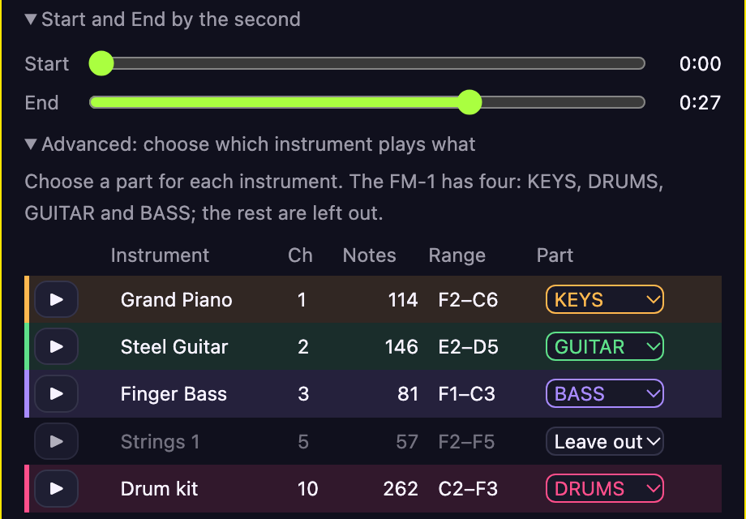<br><sub><b>1. Choose what plays (optional):</b> the parts are chosen automatically; these advanced options change them (each instrument's part or Leave out, heard alone with ▶) and shorten the song (Start, End)</sub></td>
</tr>
<tr>
<td align="center" valign="top">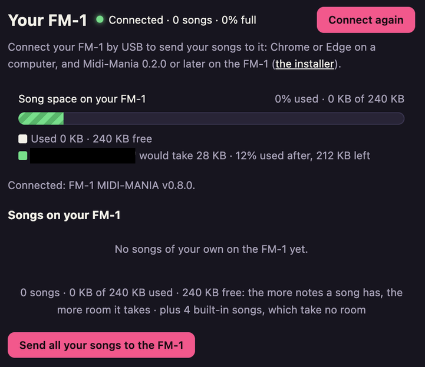<br><sub><b>2. Send it to your FM-1:</b> the room on it, and what the song will take (green: it fits)</sub></td>
</tr>
</table>

1. The easy way: drop it on **[FM-1 Midi-Mania Studio](https://shan-sherif.github.io/fm-1-midi-mania/webapp/studio/)**
   (Your songs) to try it in the browser, then connect your FM-1 there and send it on. Studio sets it up for you: its
   piano, drums, guitar and bass go to the FM-1's four parts, and the card shows what the song will hold. **Preview**
   plays it on the FM-1's sounds; **Load** loads it. **Advanced** lists each instrument (its notes and range, in its
   part's colour) to change its part (KEYS, GUITAR, BASS, the drum kit DRUMS, or Leave out: say, the melody on a sax
   onto KEYS) or to hear it alone; a preview playing follows your changes. A **piano roll** of the whole file (each instrument in its
   part's colour) has two handles that set where the song starts and ends, snapped to beats (only the notes in
   between are kept; a preview's playhead runs along it); click anywhere else on it to hear the song from there. The
   card's title is the one SONGS will show: click it to change it (24 characters). Drop the same file again later and
   your choices for it (parts, start and end, title) come back; **Start over** clears them. It is converted in the
   browser as below, your choices over the converter's.

   **Room on the FM-1:** an FM-1 keeps 240 KB of songs (up to 16); a song's size comes from its notes. Studio loads a
   song whatever its size and plays it there, and says in amber when it is too big for an FM-1, with about how long a
   part of it would fit; **Fit to FM-1** keeps the start and moves the end back to where it fits. The **Your FM-1** panel shows the song space as a bar (how full, in KB and per cent) with the
   song you're looking at on top of it, green if it fits and red if it doesn't, changing as you shorten it; connected,
   it shows your FM-1's own songs and room, and the connection's state is shown at the top of the page too. **Send**
   checks your FM-1's free room first and tells you if it doesn't fit (delete a song on the FM-1, or load a shorter
   version).

   **The note ranges each part keeps** (KEYS, GUITAR, BASS: notes outside are left out, so they never take a voice;
   Studio counts them):

   | Part | Range | |
   |---|---|---|
   | KEYS | C2 to C7 | a 61-key keyboard |
   | GUITAR | E2 to E6 | a guitar's open low E to its 24th fret on the high E |
   | BASS | E1 to G4 | a 4-string bass, to its 24th fret on the G |
   | DRUMS | every note on channel 10 | General MIDI drums 35 to 81 as themselves; any other note as its octave of 36 to 47 |

   (C4 is middle C.) The game then lays the notes out by your STYLE: KEYS on 49 KEYS shows C2 to C6, the FM-1's own
   27 keys F3 to G5; notes outside what you play are folded onto it by octaves, or played for you (KNOB 4, AUTO).
   To build songs into the firmware instead, put `.mid` files in `midi/`. Files there are git-ignored: songs are
   usually copyrighted, so they stay on your computer. Four songs, all written for this project, are always built
   in, to try straight away on the FM-1 and in the browser ([assets/songs/](assets/songs/README.md) records them):
   - **FM Beats** for DRUMS, a groove using all eight drum lanes;
   - **FM Keys**, **FM Guitar** and **FM Bass**, short pieces, one for each of those parts, each with a light drum
     backing.
2. Build: `./build.sh sdl` or `./build.sh web`. `tools/gen_songs.py` converts every file in `assets/songs/` and
   `midi/` into `build/gen/midimania_songs.h`, so the songs are built into the firmware.
3. On the FM-1 (or the desktop or browser build), the panel:

| Button | Opens |
| --- | --- |
| **HOME** | the **game** (the play page): your part's notes falling towards the hit line, the key LEDs lit as they sound (ARP too). Held: MENU |
| **SEQ** | **SONGS**, the song list (also at power-on); SEQ again opens **GAME** |
| **FX** | **GAME**, the game's settings |
| **EDIT** | the **MIXER** |
| **SCL** | **METRONOME** |
| **SAVE** | **PRESETS**: the selected part's sounds |
| **PLAY** | plays the selected song (and opens the game), or stops the one playing |
| **ENV** | **SOUNDS**: each part's sound, a knob a part |
| LFO, GLO, REC | nothing |

   **ALGORITHM** picks your part from anywhere: **1 KEYS** (piano), **2 DRUMS**, **3 GUITAR** or **4 BASS** (those the
   song has). The keys play it; the header shows it at the right ("1 KEYS"). How its notes are laid out is its
   **STYLE** (SONGS, below). **PRESETS** picks its sound, shown at the bottom left.

   In **SONGS**:
   - **SELECT** picks a song. The first row is **FREE PLAY** (selected at power-on): no song, your part on its sound;
     on the play page every key you press (on the panel, or a MIDI note on your part's channel: 1 to 4)
     appears at the hit line and moves away from it (the opposite way to a
     song's notes), and the header says FREE PLAY. PLAY stops it;
   - **PRESETS** picks your part's **SOUND** (its list: The four parts, below);
   - **ALGORITHM** picks your part (the PART row);
   - **KNOB 1 MODE:** **CPU**, the FM-1 plays your part, or **PLAY**, your part is silent and you play it on the keys
     (its keys still light as the notes arrive). A note you don't press stays silent; a key pressed within 110 ms of
     one of your notes on it plays the song's note, otherwise the key's own sound. **PLAY is scored:** each of your
     notes is PERFECT (within 30 ms), GREAT (60 ms), GOOD (110 ms) or, not pressed, MISS; the grade shows over the hit
     line (GREAT and GOOD say EARLY or LATE), the combo in the middle, the score at the left (300 a PERFECT, 200 a
     GREAT, 100 a GOOD). When the song plays to its end, HOME shows the result: the score, the accuracy, each grade's
     count and the longest combo, until the next song. A MIDI keyboard on your part is scored the same;
   - **KNOB 2 TEMPO:** 1 BPM a detent, from half to twice the song's own BPM (shown beside it); **OCT-** puts it back;
   - **KNOB 3 STYLE**, how your part is laid out and played:
     - KEYS: **49 KEYS** (C2 to C6 on the screen; the FM-1's 27 keys are a window on them that **OCT-** and **OCT+**
       move, marked under the keyboard; a 49-key MIDI keyboard plays all of them), **27 KEYS** (the FM-1's own keys,
       F3 to G5, the default) or **1 OCTAVE** (12 lanes, C to B: any key of that name plays it);
     - DRUMS: **FULL**, **QUARTER** (only the hits on a beat: no 8ths or 16ths) or **HALF** (only beats 1 and 3);
       the hits you skip are played by the FM-1;
     - GUITAR, BASS: **STRINGS** or **CHROMATIC** (the game, below);
   - **KNOB 4 AUTO**, which of your part's notes are yours (the FM-1 plays the rest):
     - KEYS: **FULL** (every note, folded onto the style's keys by octaves), **CURRENT RANGE** (only the notes in the
       style's range: C2 to C6, F3 to G5, or C4 to B4) or **1 OCTAVE** (only C4 to B4);
     - DRUMS: **ALL 8**, **5 PADS** (no TOM, BELL, CLAP), **4 PADS** (KICK, SNR, CH, OH) or **2 PADS** (KICK, SNR);
     - GUITAR, BASS on STRINGS: **6 LANES**, **4 LANES** or **2 LANES** (BASS 4 or 2): every note stays yours, squeezed
       onto fewer lanes; on CHROMATIC: **1 OCTAVE**, nothing to choose;
   - **PLAY** starts it and opens the game; **SEQ** again opens GAME.

   In the **game** (HOME), the header shows the song playing: the play icon, the metronome swinging on its beats
   (the accent colour on a bar's first), its tempo, and your part at the right. The panel shows your part's notes:
   - **KEYS** on 27 KEYS: lanes laid out like the FM-1's keyboard, sharps red and naturals blue; each note's start has
     a bright edge and its end a gap, so a note struck again reads as two. On 49 KEYS the same for C2 to C6, the FM-1's
     27 keys marked under the keyboard; on 1 OCTAVE as CHROMATIC below;
   - **GUITAR, BASS** on **STRINGS** (the default): 6 lanes (BASS 4; fewer with AUTO), coloured purple to red from low
     to high, played on the white keys F3, G3, A3, B3, C4, D4. The pitches your part uses in the song are spread over
     them, lowest to highest, so a higher note is never left of a lower one; you hear the note as written;
   - **GUITAR, BASS** on **CHROMATIC**: 12 lanes, C to B, named at the top: a note's lane is its name, whatever its
     octave, and any key of that name plays it (its light on C4 to B4);
   - Two of your notes on one key or lane at once (within 30 ms: a chord on one lane, an octave folded onto the same
     key) are one note to play; the device plays the other.
   - **DRUMS:** eight lanes, left to right BELL (red), OH and CH (blue), SNR and RIM (yellow), KICK (purple),
     CLAP (red), TOM (green), the names in the same colours. The key under each lane lights: the black keys F#3 to
     A#4 in that order.
   - Columns none of your notes come down (not yours with your AUTO, or not in the song) are greyed out.
   - The keyboard strip (DRUMS: the pads) lights for the song's notes as they sound and for the keys you press, on
     the panel or by MIDI on your part's channel.

   Its four cards: **KNOB 1 SPEED**, **KNOB 2 OFFSET**, **KNOB 3 TEMPO** (live), **KNOB 4 SCROLL**. While a song
   plays they are hidden and the notes panel fills their space; turning any knob shows them for 3 s. TEMPO shows a
   play icon and flashes on every beat (the accent colour on a bar's first beat).
   On DRUMS the black keys F#3 to A#4 play the drum of the lane above them.
4. **GAME** (FX), the same settings on a page of their own:
   - **KNOB 1 SCROLL:** **DOWN**, notes fall to a line at the bottom of the panel, or **UP**, they rise to a line at
     the top (the keyboard strip and the drum pads move with it);
   - **KNOB 2 NOTE SPEED:** 1 (slow: 4 s from the top of the panel to the line) to 16 (fastest: 0.4 s); 4 is 2 s, 8 is 1 s. Kept for each part: DRUMS start at 8, the others at 4;
   - **KNOB 3 OFFSET:** −100 to +100 ms, your timing calibration for the score (moves every press by it: if you are
     judged LATE when on time, turn it down); **OCT-** sets it to 0;
   - **OCT+ CALIBRATE:** a click at 100 BPM; tap any key with it. After 4 clicks to listen, 12 taps set OFFSET to
     cancel your average lead or lag ("SET: YOU TAP 14 MS LATE"); **OCT+** again stops it;
   - **HOME** or **FX** goes back to the game; **SEQ** opens SONGS.

   Your part, MODE, AUTO, STYLE and NOTE SPEED (for each part), SCROLL and OFFSET are kept after power-off, and so
   are each part's sound and the MIXER (below, The four parts). So is
   your **best score** for each song, part, AUTO and STYLE (24 kept, the lowest giving way): the result says **NEW BEST**, or
   your best, and SONGS shows it below the list (**FC**: every note hit). They are saved with the settings
   (`firmware/src/game_save.c`), never while a song plays, and go in the installer's backup.
5. **SOUNDS** (ENV): each part's sound, a knob a part, as MIDI channels 1 to 4 play them: **KNOB 1 KEYS** (CH 1),
   **KNOB 2 DRUMS** (CH 2), **KNOB 3 GUITAR** (CH 3), **KNOB 4 BASS** (CH 4), each through its own list of sounds
   (The four parts, below). Turning a knob makes the keys play that part, to hear it; leaving the page, they play
   your part again. **ENV** or **HOME** goes back.
6. **METRONOME** (SCL), the same settings as MENU's, kept after power-off:
   - **KNOB 1 CLICK:** OFF / ON: the playing song's beats click, the first of each bar higher (it follows TEMPO);
   - **KNOB 2 LEVEL:** LOW / MID / HIGH;
   - **KNOB 3 COUNT-IN:** OFF / 1 BAR / 2 BARS of clicks before the song, at its first beat's tempo, ending a beat before
     its first beat (whatever CLICK is); the song waits for them if its start is shorter;
   - **HOME** or **SCL** goes back to the game.

### The four parts
Each part is one instrument with its own sounds (`firmware/src/engines.c` `MM_SOUNDS`):

| Part | Sounds (engine) |
| --- | --- |
| **1 KEYS** (17) | PIANO, FLUTE (SAMPLE); TINE EP, ORGAN, BELL, PAD, BRASS (FM6); HARP, KALIMBA, MARIMBA, BELL TREE (PHYS); FULL ORGAN, JAZZ PERC, GOSPEL (WHEEL); STRINGS, SINE KEY (ANALOG); CHOIR AAH (VOICE) |
| **2 DRUMS** | the DRUM engine's kits |
| **3 GUITAR** (12) | PLUCK, HARP, KALIMBA, DRONE STRING, BOWED METAL (PHYS); PWM STR, SAW LEAD (ANALOG); SYNC LEAD, ARP LEAD (TRIO); VOX LEAD (VOICE); PULSE LD, WAVE LEAD (LOFI) |
| **4 BASS** (9) | FM BASS, PLUCK (FM6); SUB BASS, SQR BASS, ACID, RAVE (ANALOG); FAT BASS (TRIO); WOW BASS (VOICE); WAVE BASS (LOFI) |

Pick the sounds three ways: **SOUNDS** (ENV), every part at once, a knob a part; in SONGS with **PRESETS** (the
SOUND row), your part's; or SAVE > PRESETS, any part's. On SOUNDS, turn a knob quickly and its part's whole list pops up
(the sound it plays filled in), to scroll through and see where you are. Nothing (a preset, a MIDI program change) can put a sound from
outside the list on a part. A song plays on the sounds you picked, and starting one leaves them as they are. MIDI IN
channels 1–4 play parts 1–4.

**Your sounds are kept by themselves**, with each part's MIXER settings (LEVEL, PAN, REV): the FM-1 saves them about
10 seconds after your last change, once nothing is playing, and puts them back at power-on ("RESTORED" on the
screen). There is nothing to press. **MENU > SYSTEM > RESTORE LAST** turns it off (OFF: every power-on starts from
the default sounds).

### What Midi-Mania leaves out of Felucca
- **The sequencer:** no STEP, DETAIL, AUTOMATION, SEQ TOOLS, recording, song chain, PHRASES, PROJECT or TOOLS, and
  no envelope, LFO, MOD or sound-editing pages (the ENV button opens SOUNDS, EDIT the MIXER). The panel as above.
- **Engines:** nine, **DRUM, SAMPLE, PHYS, FM6, ANALOG, WHEEL, TRIO, LOFI, VOICE**, each part fixed to its own
  sounds. Felucca's PHASE, GRAIN, NOISE, SLICE, ADPCM and DIGITAL engines and its plugin engines are gone (a stored sound
  of one plays a sine; the engine numbers stay as Felucca's, so its stored data still reads). No user presets, no
  FM6 operator pages. The FLUTE and SAX samples' numbers play PIANO.
- **Effects:** a light reverb (ROOM) only, off by default: each part's **REV** on the MIXER (KNOB 3) is 0 at
  power-on and stays as you set it when you change the part's sound. While every REV is 0 the reverb doesn't run,
  which saves about a third of the audio work. No delay, chorus, distortion, insert effects, SLICER or perform FX.
- **Keys:** they play their own notes: no layers, SCALE, chord keys or arpeggiator.
- **Platforms:** the libretro core.

Kept: the MIXER, PRESETS, naming, MIDI learn, MIDI IN, the metronome (now on the song's beats), MENU, backups and
updates. The CLOCK page (BPM, SWING, external clock) is gone: it drove the sequencer.

The removed engines, plugins, platforms and their tests are deleted from the tree. Some of the sequencer's, the
layers' and the hidden pages' code is still compiled though never reached: it is woven into code that stays (the
keyboard, MIDI IN, the stores), so it comes out one module at a time.

How a file is fitted to the FM-1 (`tools/gen_songs.py`, and Studio's `web/mm_songs.js`, byte for byte the same):
four modes, one per part. The instruments below are the parts' default sounds; a song plays on the ones you picked.
In Studio, **Advanced** puts any instrument on any part instead.

| Mode | Part | MIDI instruments | Default sound |
| --- | --- | --- | --- |
| KEYS | 1 | General MIDI programs 0–23 (pianos, chromatic percussion, organs) | SAMPLE PIANO |
| DRUMS | 2 | channel 10 | DRUM kit |
| GUITAR | 3 | programs 24–31 | PHYS PLUCK |
| BASS | 4 | programs 32–39 | FM6 FM BASS |

- A flute (General MIDI's flute family, programs 72–79: piccolo, flute, recorder, pan flute ... ocarina) is
  compared with the piano parts: whichever has more notes plays KEYS, and the other is dropped.
- Every other instrument is dropped. If nothing is KEYS, the busiest dropped instrument plays KEYS, so a melody on
  a harp, strings or a lead still has a part.
- Notes outside the instrument's range are dropped, so they never take a voice: KEYS C2–C7 (a 61-key keyboard),
  GUITAR E2–E6, BASS E1–G4.
- Notes doubled within a mode play once.
- At most 8 notes sound at once. A note of a mode that matters more takes the voice of a held note of one that
  matters less (DRUMS, then KEYS, GUITAR, BASS: bass gives way first); otherwise it is dropped.
- A song starts at least 2 seconds before its first note: longer silence is cut; a song that starts at once (Amen
  Break) gets whole bars of silence added, so its notes fall in from the top and the beats (the metronome,
  COUNT-IN) stay on the bar.
- A song plays on its parts with the sound you picked for each (SOUNDS, PRESETS).

## How it works

1. **On a computer**, `tools/gen_songs.py` converts a Standard MIDI File into a chart:
   - the notes you play, each with its key on the FM-1's 27 (the game lays them out by your STYLE: 49 or 27 keys,
     an octave, strings or chromatic lanes);
   - the backing parts, fitted to the FM-1's 4 synth parts and 8 voices;
   - the beat times.
2. **The chart goes to the FM-1:** sent over USB from Studio and stored in its flash
   (`firmware/src/editor_songs.c`, [docs/CHART_FORMAT.md](docs/CHART_FORMAT.md)), or built into the firmware
   (`assets/songs/`, `midi/`).
3. **On the FM-1**, the audio interrupt plays the backing with sample-accurate timing. It sounds your keys and passes
   each press to the judge (`firmware/src/judge.c`, through `player.c` `player_judge_key`), timed by the key scan's
   own tick of the key closing (about 0.1 ms; a MIDI keyboard's notes: the audio block they arrive in, 2.9 ms).

More: [docs/GAME_ARCHITECTURE.md](docs/GAME_ARCHITECTURE.md) · [docs/GAME_DESIGN.md](docs/GAME_DESIGN.md) ·
[docs/CHART_FORMAT.md](docs/CHART_FORMAT.md) · and from Felucca: [docs/ARCHITECTURE.md](docs/ARCHITECTURE.md),
[docs/PORTING.md](docs/PORTING.md)

## Layout

```
firmware/src/       the application (Felucca's, now ours) and the game: midimania.c (the FM-1's top), player.c,
                    ui_songs.c, chart.h, judge.c
firmware/hal/       hardware headers
firmware/bsp/       the FM-1 hardware layer (from felucca-bsp, MPL-2.0)
firmware/engines/   ANALOG, LOFI, TRIO, WHEEL and the shared DSP (from Felucca-Engines, MIT)
firmware/loader/    the update loader
platforms/          host builds on a simulated FM-1: desktop (SDL2) and browser (platforms/host/mm_host.c)
tools/              build, generators, installer, MIDI → chart converter (gen_songs.py)
tests/              tests that run on a computer (tests/run_tests.sh)
web/                the installer; the MIDI converter (mm_songs.js) and the FM-1 song upload (fm1songs.js) Studio uses
assets/             fonts, icons, samples
docs/               documentation
```

The repository stands alone: no submodules. A normal `git clone` has everything.

## Building

- **The FM-1 firmware** needs Linux: JieLi's compiler runs only on Linux x86-64. On Windows, use **WSL 2** (or
  Docker).
- **The desktop and browser builds** run the same firmware on a simulated FM-1.
- With WSL you still test everything from Windows:
  - the desktop build opens a window on Windows (WSLg);
  - the browser build, **FM-1 Midi-Mania Studio**, opens in Chrome or Edge;
  - the FM-1 is installed from the browser on Windows.

The installer page (`web/`) only installs; it doesn't build anything.
See [BUILDING.md](BUILDING.md), and [docs/BUILDING_WINDOWS.md](docs/BUILDING_WINDOWS.md) for Windows.

## Installing on an FM-1

Use [the installer](https://shan-sherif.github.io/fm-1-midi-mania/webapp/installer/) in Chrome or Edge, at your own
risk. Updating from an earlier Midi-Mania keeps the songs you've loaded onto your FM-1. It works on FM-1s with the
older flash chip (ID `0x856014`); the newer flash chip (`0xB36014`, [below](#the-newer-fm-1-flash-chip)) is not
verified on a physical device yet: try at your own risk. Coming from another custom firmware, accept only their own updates or the official one (the FM-1 shows "update failed", nothing is written); go back to the official V15 with
that firmware's own tool (or M-VAVE's M-UPGRADE) first, then install Midi-Mania.
**Return to official V15** (with the official `FM-1.fwsc` from M-VAVE) takes the FM-1 back to stock. If an install fails and the FM-1 does not start, recovery needs
[FM-1-transporter](https://github.com/kurogedelic/FM-1-transporter).

Before **Return to official V15**, the installer saves a backup file to your computer (`Midi-Mania-backup-DATE.json`):
your settings, sounds and uploaded songs. After installing Midi-Mania again, **Restore a backup** on the same page puts
it back. Songs already on the FM-1 stay, and the backup's other songs are added. The file is `"midi-mania-backup"`;
older ones, saved as `"felucca-backup"` (Felucca's name for the same format) before 0.2.0, still restore, without songs.

### The newer FM-1 flash chip

For Midi-Mania and the other Felucca-based firmware (Felucca itself, SLOOP):
the FM-1's firmware drives its flash with the standard SPI flash commands (read `0x03`, write `0x02`,
4 KB erase `0x20`, status `0x05`, write enable `0x06`), and both chips understand them the same way. Both also hold
1 MB, so everything sits in the same place. What differed was only a safety check: at power-on the firmware asks the
chip for its ID (command `0x9F`) and uses the flash only if it recognises the answer. These firmwares knew only the
older chip's `0x856014`, so a newer FM-1 (`0xB36014`) was treated as an unknown chip: nothing was saved to flash
(settings and saved data lost at power-off), and
where the update loader checks the chip too, updates were refused. Adding the second ID to that check, at power-on
(`persist_boot`) and in the update loader, lets the same firmware and the same flash code work on both chips; any
other chip is still refused. Felucca made this fix in
[`f4cbb6a`](https://github.com/hugelton/Felucca/commit/f4cbb6a2a0a35e068d4f063083d464eb4dbaa415)
([issue #320](https://github.com/hugelton/Felucca/issues/320)), SLOOP in
[`bac9c05`](https://github.com/isod89/sloop-fm1/commit/bac9c05ea7627449405aa10e48da21d75b6c8c56), and Midi-Mania
in 0.9.0.

## Based on Felucca

Copied on 2026-11-02

| Here | From | Commit |
| --- | --- | --- |
| everything else | [hugelton/Felucca](https://github.com/hugelton/Felucca) | `40762f2` |
| `firmware/bsp/` | [hugelton/felucca-bsp](https://github.com/hugelton/felucca-bsp) | `5942e68` |
| `firmware/engines/` | [hugelton/Felucca-Engines](https://github.com/hugelton/Felucca-Engines) | `0f015ad` |

## Licence and credits

GPL-3.0-only ([LICENSE](LICENSE)), as Felucca. The engines (`firmware/engines/`) are MIT and the hardware layer
(`firmware/bsp/`) is MPL-2.0. Bundled fonts, samples and ported DSP keep their own licences ([LICENSING.md](LICENSING.md),
[LICENSES/](LICENSES/)). Files carried over from Felucca keep its copyright notice. Thanks to Felucca's author and
contributors: [CREDITS.md](CREDITS.md).

M-VAVE and FM-1 are trademarks of their respective owners. This project is not affiliated with or endorsed by them.
